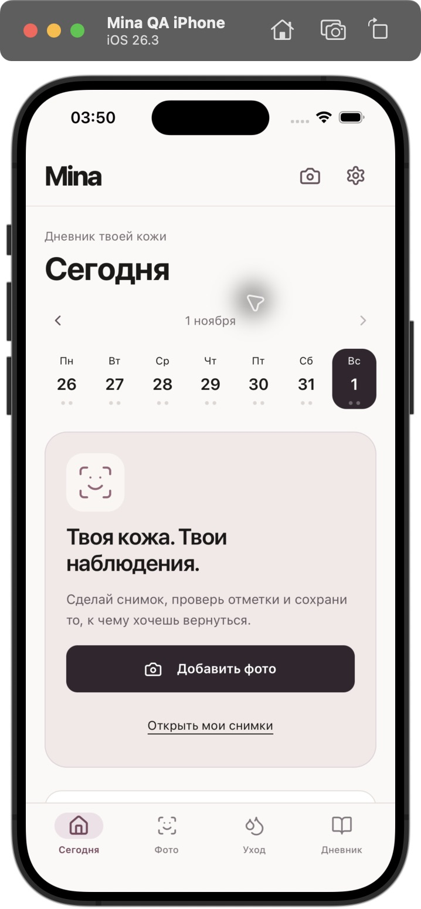
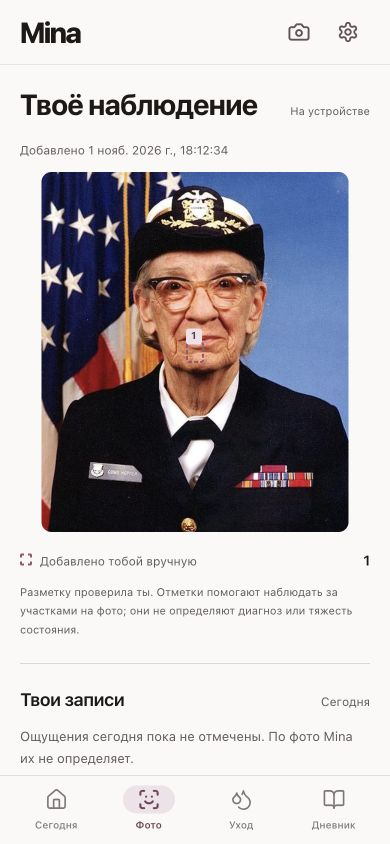

# Mina — iPhone Skin Journal & Local AI Checks

<p align="center">
  
</p>

<p align="center">
  <strong>Бережный дневник ощущений кожи, честный уход и локальное компьютерное зрение для iPhone («Flo для лица»)</strong>
</p>

<p align="center">
  
  
  
  
  
  
  
</p>

---

## О проекте / Overview

**Mina** — русскоязычный дневник ощущений кожи и повседневного ухода за лицом. Концептуальный референс — метафора «Flo для лица»: вместо тяжелых псевдонаучных диагнозов и вымышленных «процентов здоровья», пользователь получает заботливый, эстетичный трекер с локальным ИИ, работающим **прямо на устройстве** без отправки фото на сервер.

### Ключевые возможности:
- 📱 **Нативное приложение для iPhone:** Собрано на Capacitor 8.6 с нативным Swift `PHPicker` (выбор одного фото без запроса прав ко всей медиатеке).
- 🧠 **100% On-Device AI:** 
  - **Google MediaPipe Face Landmarker (478 точек):** проверка положения, ракурса и условий кадра прямо в Web Worker.
  - **ONNX Runtime Web (YOLOv8s):** легковесная модель детекции видимых высыпаний, выполняющаяся локально на WebAssembly/CPU без серверов.
- ✍️ **Человеческая модерация рамок:** ИИ лишь предлагает подсказки; пользователь сам подтверждает, удаляет или добавляет отметки.
- 🌸 **Дневник ощущений без галлюцинаций:** Уход подстраивается под реальные ощущения («Коже комфортно», «Стянутость», «Покраснение», «Жжение») и контекст дня (ветер, кондиционер, недосып).
- 🔒 **Строгая приватность (Local-First):** Фото сохраняются только по явному выбору в IndexedDB (`mina.photos.v1`, до 20 снимков). Журнал по умолчанию хранится только в оперативной памяти сессии (с возможностью включить локальное сохранение).

---

## Интерфейс / Screenshots

| Нативный iOS (iPhone 12 Pro Max) | Дневник и ощущения | Разбор наблюдения |
| :---: | :---: | :---: |
|  |  |  |

---

## Архитектура iOS-приложения

Нативное приложение расположено в `ios/App/App.xcodeproj` и компилируется под iOS 17+.

- **Четыре основные вкладки:**
  1. **Сегодня:** календарь недели, главное действие фото-чекапа, фокус дня и статус ухода.
  2. **Фото:** локальный захват кадра, проверка лица, редактируемые метки, экран «Твоё наблюдение», локальный архив и сравнение двух снимков.
  3. **Уход:** независимые утренние (3 базовых шага) и вечерние (2 базовых шага) чек-листы, вечерняя отметка комфорта и памятки.
  4. **Дневник:** недельная сводка наблюдений, история и настройки локального сохранения.
- **Нативный мост `MinaPhoto`:** использует системный `PHPickerViewController`. Не требует и не запрашивает доступ ко всей галерее; передает только выбранный снимок, нормализует ориентацию и удаляет EXIF.
- **Подробное руководство по сборке и подписи:** см. [`docs/ios/README.md`](docs/ios/README.md).

```bash
# Подготовка ассетов моделей, статический экспорт и синхронизация Xcode:
npm run build:ios

# Верификация комплекта iOS:
npm run check:ios

# Открытие проекта в Xcode:
npm run ios:open
```

---

## Как устроен фотопоток (Photo Flow)

1. **Добавление фото:** выбор файла или снимок с камеры. Кадры сжимаются до максимальной стороны 960 px.
2. **MediaPipe Face Landmarker:** вычисляет 478 опорных точек лица в Worker. Проверяет одно лицо, центрирование, наклон линии глаз и экспозицию.
3. **ONNX YOLOv8s Acne Detector:** сканирует лицо и подсвечивает возможные высыпания (зеленые сплошные рамки).
4. **Интерактивный редактор:** пользователь оставляет, удаляет или добавляет свои метки (фиолетовые пунктирные рамки). Поддерживается управление с клавиатуры и сенсорного экрана.
5. **Экран «Твоё наблюдение»:** снимок с сохраненными метками, статус анализа (`ИИ выполнен`, `Ручная разметка`, `ИИ недоступен`), ощущения дня и обоснованный фокус ухода.
6. **Локальный архив:** фото сохраняется только по явной кнопке в IndexedDB. Доступен режим сравнения двух снимков рядом.

---

## Модели и лицензии

- **Face Model:** MediaPipe Face Landmarker float16 v1; `@mediapipe/tasks-vision@1.2.0` (`public/models/face`). Лицензия Apache 2.0.
- **Skin Detector:** `acne_detector.onnx` (`mufasabrownie/glowlytics-skin-models`, revision `a1bbdb624b6045bdb1503050c56045728f2efaf0`, 44.7 МБ, SHA-256: `de7b25f3d1e2af69ee18f2b55cb6d93edf3c8dd29662a1c64cf8d903c3fa8526`).
- **Runtime:** `onnxruntime-web@1.31.1`, CPU/WASM в отдельном Worker.
- **Раскрытие статуса лицензии:** В карточке модели указан MIT, а во встроенных метаданных ONNX — AGPL-3.0 (Ultralytics). Текущий статус — исследовательский личный прототип. До публичного коммерческого релиза модель подлежит замене на чистую MIT/Apache или собственному обучению.

---

## Запуск и тестирование локально

```bash
# Установка зависимостей:
npm install

# Подготовка локальных моделей и WASM-рантаймов:
npm run prepare:face
npm run prepare:acne

# Запуск веб-версии для локального превью:
npm run dev

# Запуск полного набора из 64 автоматических тестов:
npm test
```

### Результаты автоматических тестов:
Все **64 поведенческие группы тестов проходят успешно**:
- 13 групп правил ежедневного ухода и календаря
- 10 групп хранилища и персистентности дневника
- 5 групп эвристик захвата кадра MediaPipe
- 21 группа фотопотока, IndexedDB, временных зон и метаданных
- 15 групп демонстрационных профилей и legacy-адаптера

---

## Карта ключевых файлов проекта

```text
src/
├── app/
│   ├── page.tsx                    # Главная страница: интеграция вкладок, ухода и фото
│   └── globals.css                 # Палитра Mina, типографика, безопасные отступы iOS
├── components/
│   ├── AppNavigation.tsx           # Нижний таббар iOS (Сегодня, Фото, Уход, Дневник)
│   ├── PhotoDiary.tsx              # Локальный фотоархив и сравнение снимков
│   ├── PhotoFrame.tsx              # Отрисовка фото с нормализованными рамками ИИ и ручной разметки
│   ├── PhotoReview.tsx             # Редактор меток высыпаний с сенсорным и клавиатурным вводом
│   ├── PhotoResult.tsx             # Экран «Твоё наблюдение» с привязкой к дню ухода
│   ├── ScannerModal.tsx            # Шторка добавления снимка и запуск локальных моделей
│   ├── FloDailyPlan.tsx            # Чек-листы утреннего (AM) и вечернего (PM) ухода
│   ├── FloSymptomLogger.tsx        # Логгер ощущений («Коже комфортно», «Стянутость» и др.)
│   ├── WeeklyReview.tsx            # Недельная аналитика без ложных стрик-наказаний
│   └── JournalSettings.tsx         # Настройки приватности и включения локального сохранения
├── lib/
│   ├── acne.worker.ts              # Worker локального инференса ONNX Runtime WASM
│   ├── acneScanner.ts              # Контроллер жизненного цикла детектора высыпаний
│   ├── face.worker.ts              # Worker Google MediaPipe Face Landmarker
│   ├── faceCheck.ts                # Проверка кадра: 1 лицо, центрирование, наклон, экспозиция
│   ├── photoStorage.ts             # Транзакционный локальный архив фото в IndexedDB
│   ├── photoMetadata.ts            # Неизменяемый контекст даты добавления (защита от смены timezone)
│   ├── photoObservations.ts        # Валидация геометрии и фильтрация NMS/IoU
│   ├── dailyCare.ts                # Правила адаптации ухода под ощущения
│   └── journalStorage.ts           # Версионированное хранение текстового дневника
ios/
└── App/
    ├── App.xcodeproj               # Нативный проект Xcode для сборки на iPhone
    └── App/
        ├── MinaBridgeViewController.swift # Нативный Swift-мост PHPicker для выбора фото
        └── SceneDelegate.swift     # Инициализация окна и регистрация плагинов
```

---

## Образовательные источники (Evidence-Based Dermatology)

- [American Academy of Dermatology: Face washing 101](https://www.aad.org/public/everyday-care/skin-care-basics/care/face-washing-101)
- [American Academy of Dermatology: How to test skin care products](https://www.aad.org/public/everyday-care/skin-care-secrets/prevent-skin-problems/test-skin-care-products)
- [American Academy of Dermatology: How to apply sunscreen](https://www.aad.org/public/everyday-care/sun-protection/shade-clothing-sunscreen/how-to-apply-sunscreen)
